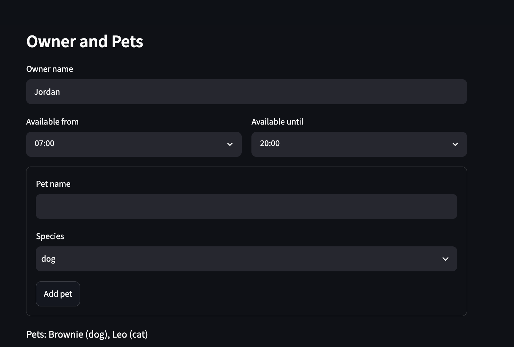
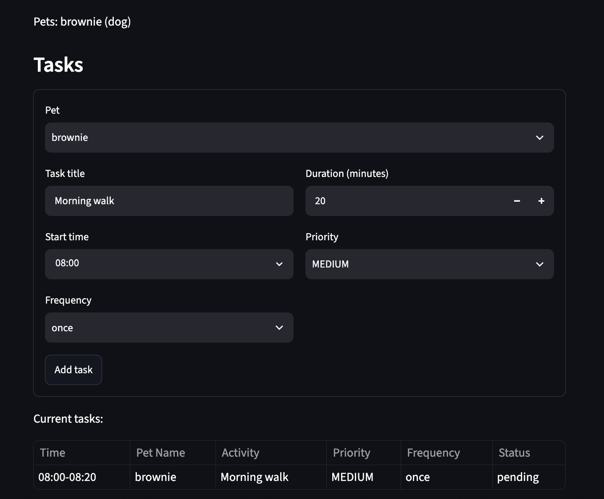
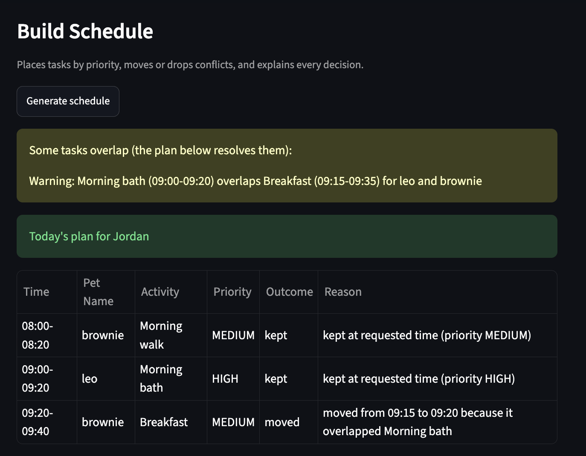
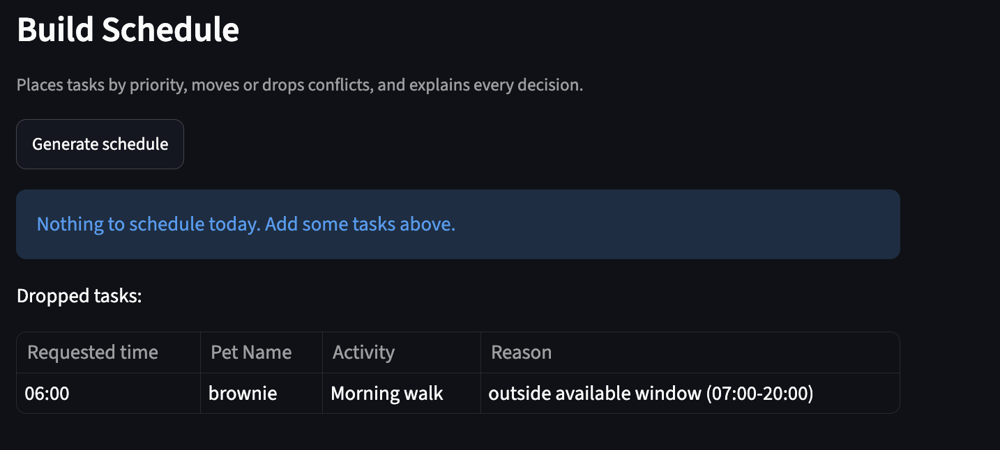

# PawPal+ (Module 2 Project)

You are building **PawPal+**, a Streamlit app that helps a pet owner plan care tasks for their pet.

## Scenario

A busy pet owner needs help staying consistent with pet care. They want an assistant that can:

- Track pet care tasks (walks, feeding, meds, enrichment, grooming, etc.)
- Consider constraints (time available, priority, owner preferences)
- Produce a daily plan and explain why it chose that plan

Your job is to design the system first (UML), then implement the logic in Python, then connect it to the Streamlit UI.

## What you will build

Your final app should:

- Let a user enter basic owner + pet info
- Let a user add/edit tasks (duration + priority at minimum)
- Generate a daily schedule/plan based on constraints and priorities
- Display the plan clearly (and ideally explain the reasoning)
- Include tests for the most important scheduling behaviors

## ✨ Features

- **Multi-pet care tracking.** One owner, any number of pets (dog, cat, or any species you type in), each with its own tasks. Pet names must be unique.
- **Task management.** Add, edit and remove tasks with a start time, duration, priority (low, medium, high) and frequency (once, daily, weekly). Invalid input (such as a task that runs past midnight) is rejected with a clear message, and a bad edit leaves the task unchanged.
- **Sorting by time.** Tasks are listed in start-time order, with creation order breaking ties so the result is always the same (`sort_by_time`).
- **Filtering.** Show one pet's tasks, only pending or only done tasks, or both filters together (`filter_tasks`).
- **Conflict warnings.** Overlapping tasks, on the same pet or across pets, produce a readable warning instead of an error. Tasks that only touch end-to-end don't count, and completed tasks and tasks on other days are ignored (`find_conflicts`).
- **Daily and weekly recurrence.** Completing a recurring task automatically adds the next one, using calendar-safe date math for month ends and leap days. Completing it twice never creates a duplicate (`complete_task`, `next_occurrence`).
- **Priority-based daily plan.** High-priority tasks claim their slots first. A task that overlaps one already placed moves to the next free slot, and a task that can't fit is dropped (`build_plan`).
- **Available-window awareness.** Tasks outside the owner's daily window are dropped from the plan.
- **Explained decisions.** Every plan entry is marked kept, moved or dropped with a plain-English reason, such as "moved from 08:00 to 08:20 because it overlapped Walk".

## Getting started

### Setup

```bash
python -m venv .venv
source .venv/bin/activate  # Windows: .venv\Scripts\activate
pip install -r requirements.txt
```

### Suggested workflow

1. Read the scenario carefully and identify requirements and edge cases.
2. Draft a UML diagram (classes, attributes, methods, relationships).
3. Convert UML into Python class stubs (no logic yet).
4. Implement scheduling logic in small increments.
5. Add tests to verify key behaviors.
6. Connect your logic to the Streamlit UI in `app.py`.
7. Refine UML so it matches what you actually built.

## Implementation Summary

The system lives in `pawpal_system.py` and is built from four main classes, with a few small helper types. The UML is in `diagrams/uml.mmd`.

- **`Owner`** holds the owner's name, their daily available window (start and end time) and their pets. `set_window()` changes the window and rejects an end that isn't after the start. `get_all_tasks()` returns every pet's tasks together as `(pet, task)` pairs.
- **`Pet`** holds a name, a species and a list of tasks, with `add_task`, `edit_task` and `remove_task`. `edit_task` only allows the editable fields and validates the new values first, so a bad edit leaves the task unchanged.
- **`Task`** is one activity: a name, a fixed start time, a duration, a priority (`LOW`, `MEDIUM` or `HIGH`, default `MEDIUM`), a frequency (`ONCE`, `DAILY` or `WEEKLY`), a due date and a completed flag. `next_occurrence()` builds the next copy of a recurring task. It computes its own end time and checks whether it overlaps another task.
- **`Scheduler`** is the brain. It reads tasks only through `Owner.get_all_tasks()`, so it plans across all pets at once. It places tasks by priority, then earlier time, then the order they were created. A task that overlaps a higher-priority one is moved to the next free slot later in the day, or dropped if none exists. A task outside the owner's window is dropped. Each decision is recorded as a `PlanEntry`. `sort_by_time` and `filter_tasks` (by pet name or completion status) work on the `(pet, task)` pairs, and `complete_task` marks a task done and automatically adds the next occurrence of a daily or weekly task to its pet.
- **`PlanEntry`** is one line of the plan: the task, the pet's name, its final start time, an outcome (`KEPT`, `MOVED` or `DROPPED`) and the reason, which is what lets the plan explain itself.

How they work together: an `Owner` has `Pet`s, each `Pet` has `Task`s, and the `Scheduler` turns all of the owner's tasks into a list of `PlanEntry` objects.

**Status:** the classes, validation, sorting, filtering, recurring tasks, conflict detection, `build_plan()`, the `main.py` demo and 41 tests are done. `Pet.edit_task` and `Pet.remove_task` are implemented, and the Streamlit app can add pets and tasks, edit, remove or mark a task complete (which adds the next occurrence of a daily or weekly task), and generate the plan with its reasoning.

## 🖥️ Sample Output

Running `python main.py` prints a sample day for two pets. The full output is shown in the Demo Walkthrough below.

## 🧪 Testing PawPal+

Run the full test suite from the project folder:

```bash
python -m pytest
```

Output of a successful run:

```
============================= test session starts ==============================
platform darwin -- Python 3.14.7, pytest-9.1.1, pluggy-1.7.0
rootdir: .../ai110-module2show-pawpal-starter
configfile: pytest.ini
testpaths: tests
plugins: anyio-4.15.1
collected 41 items

tests/test_pawpal.py .........................................           [100%]

============================== 41 passed in 0.03s ==============================
```

**What the 41 tests cover** (all in `tests/test_pawpal.py`)

| Area | What is checked |
|------|-----------------|
| Sorting | Tasks come back in time order, equal times fall back to creation order, and the input list isn't modified |
| Filtering | By pet, by completion status, by both, and an unknown pet gives an empty result |
| Recurring tasks | A daily task creates a copy due tomorrow and a weekly one a week later. A one-time task creates nothing, completing twice doesn't duplicate, and a late or early completion still gets the right date |
| Conflict detection | Warnings for the same time or an overlap, on the same pet or different pets. No warning for back-to-back or completed tasks |
| The daily plan | Priority wins a conflict, ties go to the earlier time then creation order, and tasks are moved past a chain of blockers. Tasks with no free slot or outside the window are dropped, completed and other-day tasks are skipped, every entry has a reason, and rebuilding doesn't duplicate entries |
| Editing | Valid edits apply, bad edits are rejected and leave the task unchanged, removal works, and edits change the regenerated plan |
| Owner window | `set_window` updates the window and rejects a bad one, and changing it changes the plan |
| Boundaries and validation | Exact-fit and one-minute-over windows, empty owners and pets, and rejected bad input (zero duration, end past midnight, inverted window, duplicate pet names) |

**Confidence level: ★★★★☆ (4 out of 5)**

I'm confident in the scheduling rules themselves. Each one has a test, and I confirmed the tests catch real mistakes by temporarily breaking the code (reversed priority, a missing drop, an off-by-one window) and watching them fail. I stopped short of five stars because:
- The Streamlit app was checked with throwaway test-runner scripts but has no automated tests in the suite.
- The plan places tasks greedily by priority, so it can drop a task that a smarter arrangement would have kept. The tests confirm the rule is applied consistently, not that the result is optimal.
- Blank task names are accepted, and a plan that crosses midnight is untested.

## 📐 Smarter Scheduling

| Feature | Method(s) | Notes |
|---------|-----------|-------|
| Task sorting | `Scheduler.sort_by_time()` | Orders `(pet, task)` pairs by start time, using task id to break ties. |
| Filtering | `Scheduler.filter_tasks()` | Filters by pet name, completion status, or both. |
| Conflict detection | `Scheduler.find_conflicts()` | Returns warning messages for overlapping tasks, never an error. |
| Recurring tasks | `Task.next_occurrence()`, `Scheduler.complete_task()` | Completing a daily or weekly task adds the next copy automatically. |
| Daily plan | `Scheduler.build_plan()` | Priority-first placement; moves or drops conflicting tasks and explains each decision. |

**Sorting.** `Scheduler.sort_by_time(pairs)` returns a new list of `(pet, task)` pairs sorted by `Task.start_time`, using `sorted()` with a lambda key of `(start_time, id)`. Two tasks at the same time keep their creation order, so the result is always the same. The input list is not changed.

**Filtering.** `Scheduler.filter_tasks(pet_name=None, completed=None)` reads every pet's tasks through `Owner.get_all_tasks()` and keeps only those that match. `pet_name="Rex"` keeps one pet's tasks, `completed=False` keeps pending tasks and `completed=True` keeps finished ones. A filter left as `None` is skipped, so the two can be combined. Its output feeds straight into `sort_by_time`.

**Conflict detection.** `Scheduler.find_conflicts()` is deliberately lightweight: it returns a list of warning strings instead of raising an error, so the program keeps running. An empty list means no conflicts.
- It compares tasks across all pets, so it catches an overlap on the same pet and between different pets. The message names the pets involved.
- A conflict is any overlap in time, not just an identical start. Two tasks that only touch (one ends exactly when the next starts) don't conflict.
- Completed tasks and tasks due on different days are ignored.
- The pending tasks are sorted by start time first, so each task is compared only with the tasks that start before it ends. The loop stops early after that, which keeps the check fast as the task list grows.

Example output from `main.py`:

```
Warning: Play session (12:30-12:50) overlaps Vet call (12:30-12:45) for Mia and Rex
Warning: Grooming (17:00-17:45) overlaps Training (17:15-17:45) for Rex
```

**Recurring tasks.** `Task.next_occurrence()` builds the next copy of a task. It's due today + 1 day for `DAILY` and today + 7 days for `WEEKLY` (counted from the task's own due date instead if that is later, so finishing a future copy early never creates two copies for the same day), calculated with `timedelta` so month ends, year ends and leap days are handled. `ONCE` tasks return `None`. `Scheduler.complete_task(pet, task)` marks the task complete and adds that copy to the pet, so the next occurrence is created automatically. Completing a task twice does not create a duplicate.

**Building the plan.** `Scheduler.build_plan(day=today)` combines these pieces into the daily plan. It takes the pending tasks due that day and places them by priority (high first), then earlier time, then creation order.
- A task outside the owner's window is **dropped** ("outside available window").
- A task that overlaps one already placed is **moved** to the next free slot later in the day, or **dropped** ("no free slot left in the day") if none fits before the window closes.
- Every entry is a `PlanEntry` with an outcome (`KEPT`, `MOVED` or `DROPPED`) and a plain-English reason. `Task` objects are never changed, so rebuilding the plan after an edit is always clean.

Example output from `main.py`:

```
Time        | Pet Name | Activity       | Priority | Outcome | Reason
07:30-08:00 | Rex      | Morning walk   | HIGH     | kept    | kept at requested time (priority HIGH)
12:30-12:45 | Rex      | Vet call       | HIGH     | kept    | kept at requested time (priority HIGH)
12:45-13:05 | Mia      | Play session   | MEDIUM   | moved   | moved from 12:30 to 12:45 because it overlapped Vet call
17:15-17:45 | Rex      | Training       | MEDIUM   | kept    | kept at requested time (priority MEDIUM)
17:45-18:30 | Rex      | Grooming       | LOW      | moved   | moved from 17:00 to 17:45 because it overlapped Training

Dropped
06:00  Rex   Early meds     outside available window (07:00-20:00)
```

## 📸 Demo Walkthrough

Start the app with `streamlit run app.py`. (For a terminal version of the same logic, run `python main.py`.)

### Main features and what a user can do

- **Owner and pets:** set the owner's name and daily available window (default 07:00-20:00), and add pets with a name and a species of dog, cat, or any kind you type under "other". Duplicate pet names and an end time that isn't after the start show an error.
- **Tasks:** add a task with a title, start time, duration, priority and frequency (once, daily or weekly). Edit or remove it later, or mark it complete.
- **Task list:** shown sorted by time, with filters for pet and status (pending or done).
- **Schedule:** "Generate schedule" shows conflict warnings, then the plan with an outcome and reason for every task, plus a "Dropped tasks" list.

### Example workflow

1. **Enter owner and pet info.** Under "Owner and Pets", type the owner's name and add a pet, for example Rex the dog.
2. **Add tasks.** Pick the pet and add "Morning walk" (07:30, 30 min, High, daily) and "Grooming" (17:00, 45 min, Low, weekly). The task table lists them sorted by time.
3. **Filter and edit.** Use "Filter by pet" and "Filter by status" to narrow the list. Under "Edit or remove a task", choose a task and press "Save changes", "Mark complete" or "Remove task". Completing a daily or weekly task adds the next occurrence and the app says when it's due.
4. **Generate today's schedule.** Press "Generate schedule". Overlaps are listed in a warning, and the plan table shows each task's final time, priority, outcome and reason.
5. **Read the explanations.** Higher-priority tasks keep their slots, and lower-priority overlapping tasks are moved to the next free slot with a reason such as "moved from 17:00 to 17:45 because it overlapped Training". Tasks outside the owner's window or with no free slot appear under "Dropped tasks".

### Scheduler behaviors shown

- **Sorting:** the same tasks printed unsorted and then sorted by start time.
- **Filtering:** Rex's tasks only, pending tasks, completed tasks, and one pet's pending tasks.
- **Conflict warnings:** overlapping tasks are reported as readable warnings across pets, without stopping the program.
- **Priority-based plan:** high-priority tasks are kept, lower-priority ones are moved (Play session 12:30 to 12:45, Grooming 17:00 to 17:45) and out-of-window tasks are dropped (Early meds).
- **Recurrence:** completing a daily or weekly task creates the next one, and a once task creates none.

### Sample CLI output (`python main.py`)

```
Today's Schedule for Jordan (07:00-20:00)

All tasks as added (unsorted)
Time        | Pet Name | Activity       | Priority | Frequency
------------------------------------------------------------
17:00-17:45 | Rex      | Grooming       | LOW      | weekly
07:30-08:00 | Rex      | Morning walk   | HIGH     | daily
12:30-12:45 | Rex      | Vet call       | HIGH     | once
17:15-17:45 | Rex      | Training       | MEDIUM   | once
06:00-06:10 | Rex      | Early meds     | HIGH     | once
12:30-12:50 | Mia      | Play session   | MEDIUM   | once
08:00-08:10 | Mia      | Breakfast      | HIGH     | daily

All tasks, sorted by time
Time        | Pet Name | Activity       | Priority | Frequency
------------------------------------------------------------
06:00-06:10 | Rex      | Early meds     | HIGH     | once
07:30-08:00 | Rex      | Morning walk   | HIGH     | daily
08:00-08:10 | Mia      | Breakfast      | HIGH     | daily
12:30-12:50 | Mia      | Play session   | MEDIUM   | once
12:30-12:45 | Rex      | Vet call       | HIGH     | once
17:00-17:45 | Rex      | Grooming       | LOW      | weekly
17:15-17:45 | Rex      | Training       | MEDIUM   | once

Rex's tasks only
Time        | Pet Name | Activity       | Priority | Frequency
------------------------------------------------------------
06:00-06:10 | Rex      | Early meds     | HIGH     | once
07:30-08:00 | Rex      | Morning walk   | HIGH     | daily
12:30-12:45 | Rex      | Vet call       | HIGH     | once
17:00-17:45 | Rex      | Grooming       | LOW      | weekly
17:15-17:45 | Rex      | Training       | MEDIUM   | once

Pending tasks
Time        | Pet Name | Activity       | Priority | Frequency
------------------------------------------------------------
06:00-06:10 | Rex      | Early meds     | HIGH     | once
07:30-08:00 | Rex      | Morning walk   | HIGH     | daily
12:30-12:50 | Mia      | Play session   | MEDIUM   | once
12:30-12:45 | Rex      | Vet call       | HIGH     | once
17:00-17:45 | Rex      | Grooming       | LOW      | weekly
17:15-17:45 | Rex      | Training       | MEDIUM   | once

Completed tasks
Time        | Pet Name | Activity       | Priority | Frequency
------------------------------------------------------------
08:00-08:10 | Mia      | Breakfast      | HIGH     | daily

Mia's pending tasks
Time        | Pet Name | Activity       | Priority | Frequency
------------------------------------------------------------
12:30-12:50 | Mia      | Play session   | MEDIUM   | once

Conflict check
Warning: Play session (12:30-12:50) overlaps Vet call (12:30-12:45) for Mia and Rex
Warning: Grooming (17:00-17:45) overlaps Training (17:15-17:45) for Rex

Generated Plan
Time        | Pet Name | Activity       | Priority | Outcome | Reason
----------------------------------------------------------------------------------------------------
07:30-08:00 | Rex      | Morning walk   | HIGH     | kept    | kept at requested time (priority HIGH)
12:30-12:45 | Rex      | Vet call       | HIGH     | kept    | kept at requested time (priority HIGH)
12:45-13:05 | Mia      | Play session   | MEDIUM   | moved   | moved from 12:30 to 12:45 because it overlapped Vet call
17:15-17:45 | Rex      | Training       | MEDIUM   | kept    | kept at requested time (priority MEDIUM)
17:45-18:30 | Rex      | Grooming       | LOW      | moved   | moved from 17:00 to 17:45 because it overlapped Training

Dropped
06:00  Rex   Early meds     outside available window (07:00-20:00)

Completing recurring tasks
Rex: Morning walk (daily) done -> next due 2026-10-16
Rex: Grooming (weekly) done -> next due 2026-10-22
Mia: Play session (once) done -> no next occurrence
```

### Screenshots





*Brownie's breakfast was moved from 09:15 to 09:20 to avoid a conflict.*


*Brownie's 06:00 Morning walk is dropped because it falls outside the 07:00-20:00 available window.*
